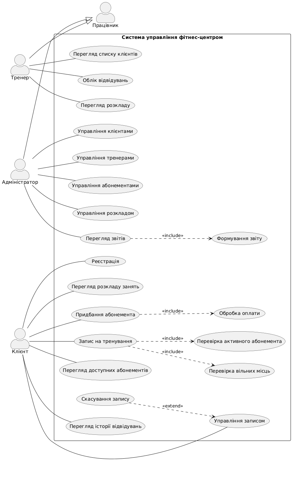
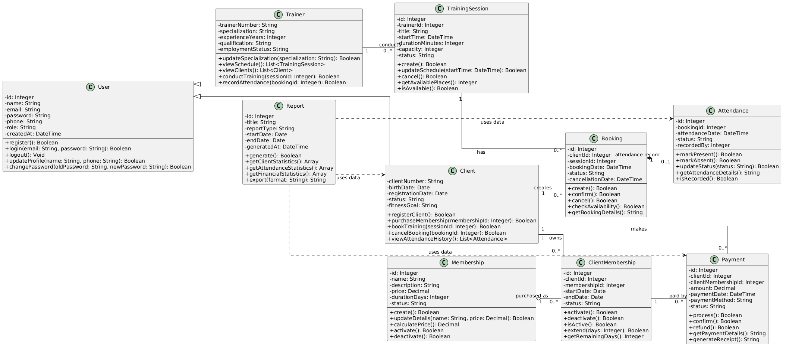

# Архітектура системи управління фітнес-центром

## 1. Опис предметної галузі

Система управління фітнес-центром призначена для автоматизації основних процесів роботи спортивного закладу. Вона забезпечує централізоване управління інформацією про клієнтів, тренерів, абонементи, тренування, записи, відвідування та платежі.

Основними користувачами системи є адміністратор, тренер і клієнт. Кожен із них має відповідні можливості залежно від своєї ролі.

## 2. Основні функції системи

Система передбачає реалізацію таких функцій:

- реєстрація та автентифікація користувачів;
- управління інформацією про клієнтів і тренерів;
- створення та редагування абонементів;
- перегляд і управління розкладом тренувань;
- придбання абонементів та обробка платежів;
- запис клієнтів на тренування та скасування записів;
- облік відвідувань;
- формування звітів про діяльність фітнес-центру.

## 3. Ролі користувачів

**Адміністратор** — управляє клієнтами, тренерами, абонементами та розкладом, а також формує звіти.

**Тренер** — переглядає власний розклад, отримує інформацію про клієнтів і фіксує їхні відвідування.

**Клієнт** — реєструється в системі, переглядає доступні абонементи та розклад, купує абонементи й записується на тренування.

## 4. Архітектура системи

Для побудови вебсистеми передбачається використання архітектурного підходу MVC (Model–View–Controller), який підтримується фреймворком Laravel.

Основні компоненти архітектури:

- **Model** — відповідає за структуру даних, взаємодію з базою даних і бізнес-логіку.
- **View** — забезпечує відображення інтерфейсу користувача.
- **Controller** — обробляє HTTP-запити, взаємодіє з моделями та повертає відповідні представлення або результати операцій.

Для зберігання даних передбачається реляційна база даних із таблицями користувачів, клієнтів, тренерів, абонементів, записів на тренування, платежів і відвідувань.

## 5. Основний сценарій використання: придбання абонемента

**Назва:** Придбання абонемента.

**Актор:** Клієнт.

**Передумови:**
- клієнт зареєстрований та автентифікований у системі;
- у системі доступні абонементи для придбання.

**Основний сценарій:**

1. Клієнт відкриває розділ доступних абонементів.
2. Система отримує перелік доступних типів абонементів.
3. Система відображає назви, вартість, тривалість і умови використання абонементів.
4. Клієнт обирає бажаний абонемент.
5. Система відображає детальну інформацію про обраний абонемент.
6. Клієнт підтверджує намір придбати абонемент.
7. Система перевіряє доступність обраного типу абонемента.
8. Система формує замовлення та визначає суму до оплати.
9. Клієнт обирає спосіб оплати.
10. Система надсилає платіжний запит до платіжного сервісу.
11. Платіжний сервіс підтверджує успішність оплати.
12. Система зберігає інформацію про платіж.
13. Система створює запис про придбаний абонемент із датами початку та завершення дії.
14. Система пов'язує абонемент із відповідним клієнтом.
15. Система відображає повідомлення про успішне придбання абонемента.

**Результат:** Абонемент закріплений за клієнтом, а інформація про оплату та термін його дії збережена в системі.

## 6. UML-діаграми

### 6.1 Діаграма варіантів використання

Діаграма відображає основних акторів системи, їхні функціональні можливості та взаємозв'язки між варіантами використання.

### 6.2 Діаграма класів

Діаграма класів відображає структуру системи, основні класи, їхні атрибути, операції та зв'язки між ними.

